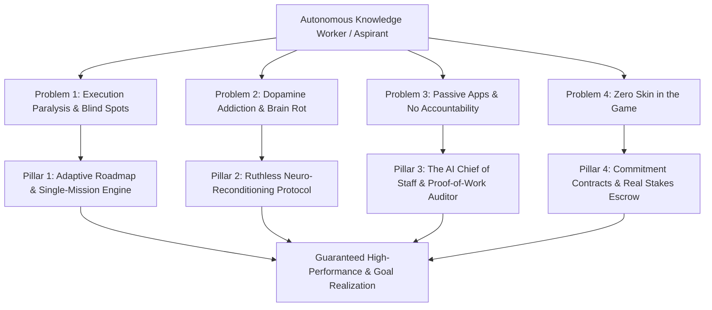

# Ascension Protocol: Core Problem Statement & Product Blueprint

## Executive Vision
Ascension Protocol is not a habit tracker or a gamified to-do list. It is an **Uncompromising High-Stakes Human Execution Engine**. 

It directly solves the **Execution Failure Epidemic** facing autonomous knowledge workers, competitive exam aspirants, and ambitious self-directed individuals.

---

## The 4 Core Problems & Their Architectural Solutions

---

### Pillar 1: Information Abundance, Execution Paralysis
* **The Core Problem:** Knowledge is free, but knowing what high-leverage action to take *right now* is paralyzing. Users get trapped in "tutorial hell" or passive studying, feeling productive while failing to build real competency.
* **The Root Cause:** High cognitive load, lack of granular diagnosis, and fragmented long-term planning.
* **The Architectural Solution (Adaptive Execution Engine):**
  - **Dynamic Diagnostic:** Continuously assesses where the user actually is vs. where they need to be.
  - **Single-Mission Lock:** Instead of an overwhelming 20-item checklist, the system assigns **one single, high-leverage mission at a time**.
  - **Adaptive Re-routing:** When a day goes wrong or a benchmark is missed, the plan automatically recalculates rather than falling apart.

---

### Pillar 2: Algorithmic Dopamine Addiction & Cognitive Decay
* **The Core Problem:** 4–6 hours lost daily to hyper-optimized algorithmic feeds (Shorts, Reels, Twitter, Reddit), resulting in broken attention spans, chronic brain fog, and destroyed deep-work capability.
* **The Root Cause:** Biological prefrontal cortex willpower is completely outmatched by billion-dollar AI algorithms designed to hijack human attention.
* **The Architectural Solution (Neuro-Reconditioning Protocol):**
  - **Hard Cognitive Air-Gaps:** Timed focus sessions that treat distraction as a critical breach.
  - **Dopamine Detox Calibration:** Progressive daily thresholds that rebuild the user's capacity for sustained 90-minute unbroken cognitive effort.
  - **Tangible Deep Work Velocity:** Replacing vanity metrics with raw *Deep Cognitive Minutes* and *Focus Density Score*.

---

### Pillar 3: Passive Apps & Zero Enforcement (The "Polite App" Failure)
* **The Core Problem:** Traditional apps sit quietly waiting to be opened. If the user feels lazy or distracted, they simply swipe away the notification. There are zero consequences for lying, skipping, or making excuses.
* **The Root Cause:** Passive tools rely on the user's existing discipline—which is the exact thing the user is struggling with.
* **The Architectural Solution (The AI Chief of Staff):**
  - **Mandatory Daily Debriefs:** Strict morning briefing (strategy) and evening debrief (retrospective audit).
  - **No Excuses / Confrontational AI:** An uncompromising voice that cross-examines missed goals rather than offering empty encouragement.
  - **Proof-of-Work Verification:** Requiring tangible receipts (code commits, photo of solved problem sets, document links) before verifying a mission as completed.

---

### Pillar 4: Zero "Skin in the Game" (The Commitment Problem)
* **The Core Problem:** Broken promises to oneself carry no immediate cost. Quitting has zero immediate penalty, so when resistance or fatigue peaks, users quit.
* **The Root Cause:** Behavioral economics shows loss aversion is 2x more potent than reward-seeking. Without real stakes, self-discipline fails under peak resistance.
* **The Architectural Solution (High-Stakes Commitment Contracts):**
  - **Stakes Escrow:** Financial or social collateral attached to weekly commitments (e.g., stake $50; if weekly deep work targets aren't hit, money goes to a charity you despise or your squad).
  - **Social Friction / Squad Accountability:** If you break discipline, your accountability squad ("Gang") feels the consequence, triggering real social accountability.
  - **Immutable Reputation Score:** A permanent, verifiable discipline rating that reflects true consistency over time.

---

## How Existing Features Map to the New Core

| Current Feature | Problem in Current State | Transformation into New Blueprint |
|---|---|---|
| **7 RPG Stats** (Strength, Charisma, etc.) | Abstract, vanity, easily gamed | **Operational Scorecard:** Deep Work Hours, Velocity Index, Proof-of-Work Accuracy, Willpower Resilience |
| **Quests System** | Random tasks / drink water | **Mission Protocol:** Single-mission adaptive roadmap aligned directly with the target career/exam milestone |
| **Focus Sanctum** | Standard Pomodoro timer | **High-Stakes Focus Chamber:** Air-gapped focus blocks with Proof-of-Work requirement to end session |
| **Partners / Gangs** | Basic chat / partner listing | **Accountability Squads:** Synchronized stakes, mutual verification of proof-of-work, shared squad reputation |
| **AI Quest Gen** | Generic advice / text generator | **AI Chief of Staff:** Active daily auditor that conducts morning/evening briefings and reviews proof |
